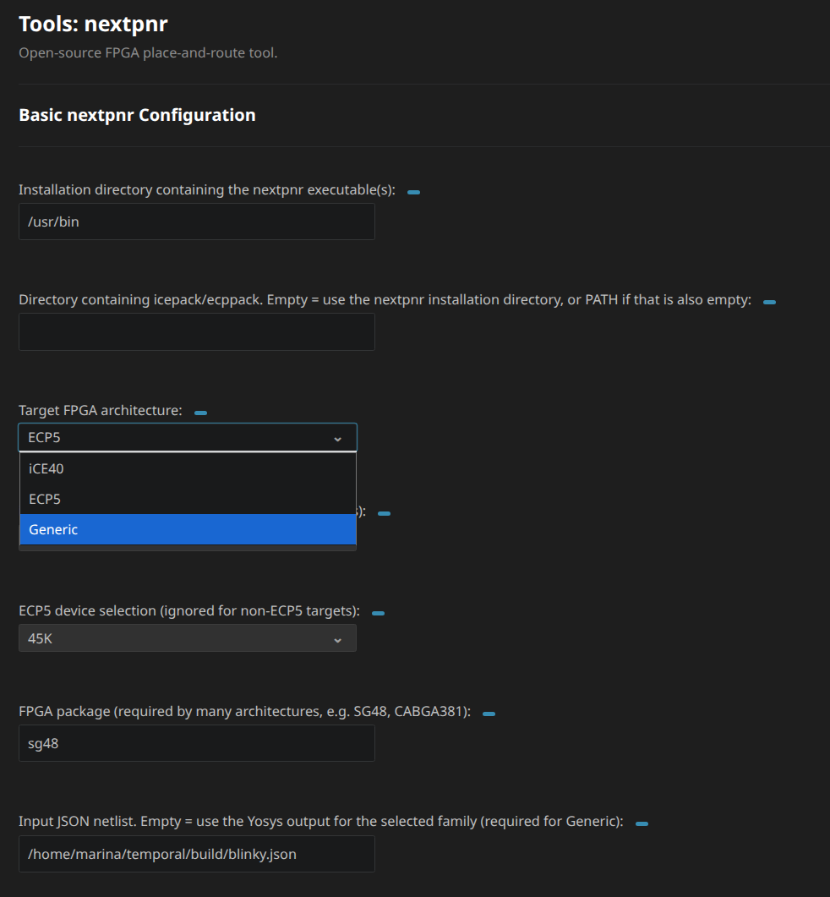
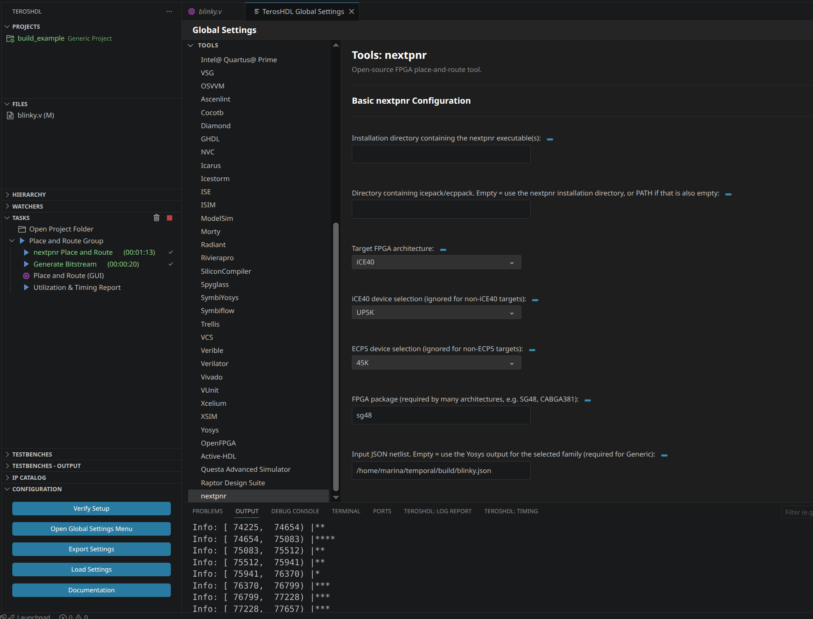
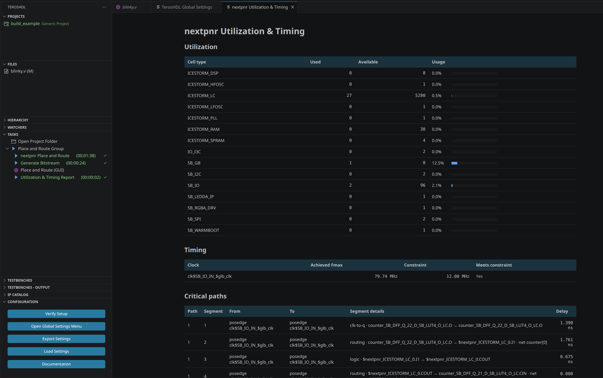

# nextpnr

## Introduction

nextpnr is the Place and Route backend integrated in TerosHDL for open FPGA flows.
The current integration supports these target families:

- iCE40
- ECP5
- Generic (P&R only)

## Prerequisites

Before running nextpnr tasks, make sure you have:

1. A project with a valid top module.
2. A JSON netlist generated by Yosys (or a valid `json_file` configured explicitly).
3. A matching target family between Yosys synthesis and nextpnr target family.

If the target family is `generic`, `json_file` is mandatory.

If you have never used the Yosys + nextpnr flow before, follow the
[step-by-step tutorial](#step-by-step-tutorial-from-hdl-to-bitstream) below.

## Configuration

Open the tool settings in TerosHDL and select `nextpnr` as the active tool.

Important fields:

- `installation_path`: Folder with nextpnr binaries.
- `packer_installation_path`: Folder with `icepack` or `ecppack`.
- `target_family`: `ice40`, `ecp5`, or `generic`.
- `ice40_device` / `ecp5_device`: Device selection for each family.
- `package`: FPGA package name (for example `SG48`, `CABGA381`) when required.
- `pcf_file` (iCE40) and `lpf_file` (ECP5): Pin constraints.
- `freq`: Target frequency in MHz.
- `seed`: Random seed for reproducible P&R.
- `extra_options`: Extra nextpnr flags (one per entry).

## Available tasks

When `target_family` is `ice40` or `ecp5`, TerosHDL shows a Place and Route task group with:

1. Run Place & Route
2. Generate Bitstream
3. Open GUI
4. Utilization & Timing

When `target_family` is `generic`, only Place & Route is available.

## Task behavior

### Run Place & Route

- Uses the configured JSON netlist as input.
- Produces family-specific output in the project folder:
  - iCE40: `nextpnr_out.asc`
  - ECP5: `nextpnr_out.config`
  - Generic: `nextpnr_out.json`
- Generates `nextpnr_report.json` for report visualization.

### Generate Bitstream

- iCE40: runs `icepack` and writes `nextpnr_out.bin`.
- ECP5: runs `ecppack` and writes `nextpnr_out.bit`.
- Generic: not supported.

### Open GUI

- Opens nextpnr GUI mode with the synthesized netlist.
- If the binary was built without Qt/GUI support, TerosHDL reports that limitation.

### Utilization & Timing

- Opens the parsed information from `nextpnr_report.json`.
- If the report is missing, run Place & Route first.

## Step-by-step tutorial: from HDL to bitstream

nextpnr does not read HDL sources directly: it consumes a JSON netlist produced by Yosys.
That means you have to configure **two tools** in your project: first Yosys (synthesis), then nextpnr (place and route).
This section walks through the whole flow using an iCE40 board as example (the ECP5 flow is identical, just pick the ECP5 options instead).

### Step 1: Configure Yosys to generate the JSON netlist

1. Open your TerosHDL project and make sure the top module is selected in the Sources view.
2. Open the project configuration and go to the **Yosys** tool settings.
3. Fill in these fields:

| Field in the UI | Value to set |
| --- | --- |
| `Synthesis target FPGA` | `iCE40 (Lattice)` if your board uses an iCE40 FPGA, or `ECP5 (Lattice)` for ECP5 boards. It **must match** the nextpnr target family you will select later. |
| `Output JSON file path` (in the *Synthesis: iCE40* section, or *Synthesis: ECP5* if you chose ECP5) | A file name for the netlist, for example `synth_out.json`. This field is empty by default and **must be filled in**, otherwise nextpnr will not find any netlist. Relative paths are resolved against the project folder. |

### Step 2: Run Yosys synthesis

1. In the project view, select **Yosys** as the active tool.
2. Run the **Synthesis** task from the Yosys task group.
3. When it finishes, the JSON netlist (for example `synth_out.json`) is written to the project folder.

### Step 3: Configure nextpnr

Open the project configuration and go to the **nextpnr** tool settings:

| Field in the UI | Value to set |
| --- | --- |
| `Target FPGA architecture` | `iCE40` or `ECP5`: the **same architecture** you selected in Yosys. |
| `iCE40 device selection` / `ECP5 device selection` | The chip on your board, for example `HX1K` for an iCE40HX1K board or `UP5K` for an iCE40UP5K board. |
| `FPGA package` | The package of your chip, for example `sg48` for UP5K or `tq144` for HX1K. Check your board documentation. |
| `PCF pin constraints file` (iCE40) / `LPF pin constraints file` (ECP5) | Path to your pin constraints file (`.pcf` or `.lpf`). |
| `Input JSON netlist` | **Leave it empty.** nextpnr automatically picks up the JSON file configured in the Yosys `Output JSON file path` field. Only set it if you want to use a netlist generated outside the Yosys tasks (mandatory for the Generic family). |

Also set `Installation directory` fields if the nextpnr and icepack/ecppack binaries are not in your `PATH`.

### Step 4: Run place and route and generate the bitstream

1. In the project view, switch the active tool to **nextpnr**.
2. Run **Run Place & Route**. nextpnr reads the JSON netlist generated by Yosys in Step 2 and produces `nextpnr_out.asc` (iCE40) or `nextpnr_out.config` (ECP5).
3. Optionally run **Utilization & Timing** to inspect the report.
4. Run **Generate Bitstream** to obtain the final `nextpnr_out.bin` (iCE40) or `nextpnr_out.bit` (ECP5), ready to be loaded into the FPGA.

:::tip

If you change the HDL sources or the Yosys configuration, re-run the Yosys **Synthesis** task before running nextpnr again, so the JSON netlist is up to date.

:::

## Troubleshooting

- Missing JSON netlist:
  - Set the `Output JSON file path` field in the Yosys configuration and run Yosys synthesis first.
  - Or configure `json_file` directly.
- Target mismatch error:
  - Align Yosys synthesis target and nextpnr target family.
- Constraints error:
  - Use `pcf_file` for iCE40, `lpf_file` for ECP5.
- Bitstream generation not available:
  - Only supported for iCE40 and ECP5.